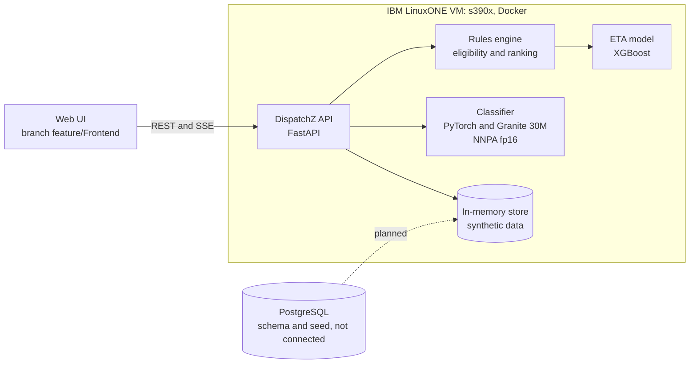

# DispatchZ

Human-in-the-loop decision support for emergency dispatch, built for the **IBM Z Datathon 2026**
(Theme 1: Real-Time AI for Critical Decisions) and running on IBM LinuxONE.

> **Prototype.** DispatchZ recommends and explains; it never dispatches. An accepted recommendation only produces a *simulated*
> assignment. All data is synthetic. It is not for real emergency use.

## Overview

A dispatcher has seconds to decide which units to send, while availability, crew qualifications, equipment and staffing keep changing.
DispatchZ takes an incident, suggests a classification (the dispatcher confirms it), derives the capabilities the response needs,
checks every unit against hard requirements, ranks the eligible ones by estimated arrival time, and explains the result, including
why a unit is **not** eligible and which requirements cannot be filled. The dispatcher accepts, modifies or rejects the
recommendation; the decision and any override are recorded in an audit trail. When conditions change (a unit goes out of service, or
is assigned elsewhere) affected recommendations are invalidated and clients are notified live.

AI only suggests a category and orders eligible units by ETA; it can never make an ineligible unit eligible.

## Features

| Status | Capability |
|---|---|
| Implemented | REST API for incidents, classification, requirements, recommendations, review, unit status, audit, and a live event stream, conforming to the [OpenAPI contract](contracts/openapi.json) |
| Implemented | Incident classification suggestion with a pretrained PyTorch model (IBM Granite Embedding 30M), human confirmation, keyword fallback |
| Implemented | Hard eligibility from unit status, staffing, crew credentials and equipment readiness; explainable ranking |
| Implemented | ETA estimation with XGBoost (trained on synthetic data), straight-line fallback |
| Implemented | Human review with override reasons, simulated assignment, stale-recommendation invalidation |
| Implemented | Docker image for IBM LinuxONE, configured to run the embedding model on the Telum NNPA accelerator in fp16 ([measurements](docs/ai-pipeline.md#evaluation)) |
| In progress | Web UI (branch `feature/Frontend`, not merged) |
| In progress | PostgreSQL persistence (schema and seed exist in [`database/`](database/); not connected to the API) |
| Planned | Demand forecasting and staffing-gap analysis, leadership reports, multi-incident optimization, road-network routing |

## Quick Start

**Prerequisites:** Python 3.12, Git. Node.js 22 for the frontend and contract tools. Docker only for the LinuxONE image.

```bash
git clone https://github.com/n-allen1/ibmz-datathon-2026.git
cd ibmz-datathon-2026

# Backend: install, test, run
python -m venv .venv
source .venv/bin/activate                  # Windows PowerShell: .venv\Scripts\Activate.ps1
pip install -r backend/requirements-test.txt
cd backend
python -m pytest -q                        # 162 passed, 5 skipped (167 with the optional xgboost package)
DEMO_MODE=true python -m uvicorn app.main:app --port 8000     # PowerShell: $env:DEMO_MODE="true"; python -m uvicorn ...
```

No database or other service is needed. Configuration variables are listed in [`.env.example`](.env.example); the API reads the process
environment and defaults are fine for a first run. Locally the API uses its rule-based fallbacks; the ML components run in the
LinuxONE image (see [development.md](docs/development.md#running-with-the-ml-components-locally)).

**Check that it works** (in a second terminal; `demo-dispatcher` is a fixed demo token, not a secret):

```bash
curl -s localhost:8000/api/v1/health
curl -s -H "Authorization: Bearer demo-dispatcher" "localhost:8000/api/v1/resources/units?limit=2"
curl -s -X POST localhost:8000/api/v1/incidents -H "Authorization: Bearer demo-dispatcher" -H "Content-Type: application/json" \
  -H "Idempotency-Key: quickstart-0001" \
  -d '{"narrative":"Chest pain, patient is not breathing","location":{"address":"12 Elm St (fictional)","point":{"lat":39.103,"lon":-95.69}},"isSynthetic":true}'
```

The first returns `"status":"ok"`, the second a page of synthetic units, the third a new incident with number `INC-2026-000001`.
A request without a token returns `401`.

The remaining commands run from the repository root (`cd ..` if you are still in `backend/`).

**Web UI** (branch `feature/Frontend`; not yet on `main`):

```bash
git fetch origin && git switch feature/Frontend
cd frontend && npm install && cp .env.example .env
# set VITE_API_TARGET=http://localhost:8000 in .env to use the backend (the default is the Prism mock on :4010)
npm run dev                                # http://localhost:5173
```

**Contract viewer and mock server:** `bash scripts/mock.sh` serves a Prism mock on `:4010` and the Swagger viewer at
`http://localhost:8080/swagger.html`.

**LinuxONE:** the image is built and run on the VM; see [docs/deployment.md](docs/deployment.md). In short:

```bash
export VM_KEY="/path/to/private-key.pem" VM_HOST="linux1@<vm-ip>"
bash scripts/deploy_vm.sh --dev     # your own test container on the VM; the shared demo API is untouched
```

The shared demo API is deployed by CI when a pull request is merged to `main` ([docs/ci-cd.md](docs/ci-cd.md)).

## Technology stack

| Layer | Technology | Purpose | Kind |
|---|---|---|---|
| API | FastAPI, Pydantic, Uvicorn | HTTP API, validation, server | Direct dependency |
| AI | PyTorch, Transformers, IBM Granite Embedding 30M | Incident classification suggestion | Direct (in the LinuxONE image) |
| AI | XGBoost | ETA estimation | Direct (in the LinuxONE image) |
| Platform | IBM LinuxONE (s390x, z/VM), Docker, `torch_nnpa` | Runtime and NNPA accelerator | External platform |
| Contract | OpenAPI 3.1, Prism, Swagger UI | Contract-first development, mock, viewer | Development tool |
| Frontend | SvelteKit, Svelte 5, Vite, Tailwind, Leaflet | Dispatcher UI (branch) | Direct dependency |
| Maps | Photon (OpenStreetMap) and Esri tiles | Geocoding and basemap, called by the browser; demo data only | External service |
| Database | PostgreSQL, Alembic | Schema and seed (not connected yet) | Planned |

Versions and the full list are in [`backend/requirements*.txt`](backend/requirements.txt) and [docs/open-source.md](docs/open-source.md).

## Architecture



Everything inside the box runs on LinuxONE; the dotted link is planned. More detail and the processing flowchart are in
[docs/architecture.md](docs/architecture.md).

## Project structure

```text
.
├── backend/          FastAPI service: app/, tests/, tools/, Dockerfile, requirements*.txt
├── contracts/        openapi.json (source of truth) and swagger.html (viewer)
├── database/         PostgreSQL schema (Alembic) and seed script; not yet connected
├── docs/             architecture, development, deployment, ci-cd, ai-pipeline, open-source, MVP plan
├── frontend/         generated API types on main; the UI is on branch feature/Frontend
├── .github/          CI/CD workflow (checks and deploy)
├── scripts/          gen_openapi.py, check_contract.py, regen_types.sh, mock.sh, deploy_vm.sh, check_platform.sh
├── .env.example      configuration variables
└── CLAUDE.md         contributor rules: contract governance and commit style
```

## API documentation

The API is **contract-first**. [`contracts/openapi.json`](contracts/openapi.json) (OpenAPI 3.1, version 0.1.2) is the single source of
truth: 41 operations in three tiers (20 `mvp`, 8 `stretch`, 13 `future`). The backend implements all 20 `mvp` operations plus
`listAuditEvents`. Open the viewer with `bash scripts/mock.sh`, or read the JSON directly.

**Changing an endpoint, schema, status code, header, role or other public interface requires explicit human approval first,**
including backward-compatible additions. See [CLAUDE.md](CLAUDE.md) and the
[contract workflow](docs/development.md#contract-first-workflow).

## IBM Z Datathon

**Theme:** Real-Time AI for Critical Decisions (Detect. Decide. Respond.). The code was written during the event window.

**How IBM Z / LinuxONE is used**

- The API and both ML components run in a Docker container on a LinuxONE VM (s390x, z/VM guest), built on IBM's `jupyterlab-image-s390x` image.
- The classifier runs PyTorch on the Telum NNPA accelerator through IBM's `torch_nnpa` plug-in. Measured on the VM: 52 of 52 suggestions
  identical to CPU, at about 6.7 ms versus 158.8 ms per narrative (p50), on small synthetic evaluation sets. Details, method and caveats:
  [docs/ai-pipeline.md](docs/ai-pipeline.md#evaluation).
- The XGBoost ETA model trains on the VM's big-endian CPU in under a second (0.07 s) and gives the same held-out error as on x86.

**Submission requirements** (from the participant guidebook): a demonstration video of at most 3 minutes (problem, supporting data,
solution, and how it uses IBM Z: tech stack, the LinuxONE instance and the model); a link to this repository; the project title
including the team name; links to the open-source resources used ([docs/open-source.md](docs/open-source.md)); and the two mandatory
prerequisite AI labs.

## Documentation

| Document | Contents |
|---|---|
| [docs/architecture.md](docs/architecture.md) | Components, system and processing diagrams, decision logic, lifecycles, persistence status |
| [docs/development.md](docs/development.md) | Local setup, tests, demo data, frontend, contract workflow, conventions |
| [docs/deployment.md](docs/deployment.md) | LinuxONE environment, Docker image, deploy and verify, verification status |
| [docs/ci-cd.md](docs/ci-cd.md) | GitHub Actions pipeline: checks, automatic deploy to the VM, one-time setup, branch protection |
| [docs/ai-pipeline.md](docs/ai-pipeline.md) | Classifier and ETA model, safety properties, evaluation, NNPA results, planned AI |
| [docs/open-source.md](docs/open-source.md) | Open-source components and attribution |
| [docs/mvp-plan.md](docs/mvp-plan.md) | Original 24-hour scope and endpoint tiers (planning document) |

## License

No license has been chosen yet; the OpenAPI contract declares the project `UNLICENSED`.
