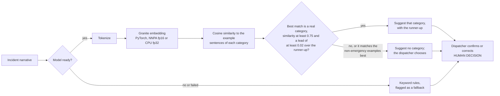

# AI pipeline

Two machine-learning components run inside the API process. Both are advisory and both degrade to deterministic fallbacks.

| Component | Framework | Pretrained or fitted | Data | Fallback |
|---|---|---|---|---|
| Incident classifier | PyTorch (`transformers`), [IBM Granite Embedding 30M English](https://huggingface.co/ibm-granite/granite-embedding-30m-english) | **Pretrained, not fine-tuned.** Nothing is trained on our data. | 3 hand-written example sentences per category (`PROTOTYPES` in `backend/app/embedding_classifier.py`), not training data | Keyword rules |
| ETA model | XGBoost (native `Booster` API) | **Fitted at start-up**, on the machine it runs on | A documented **synthetic** travel-time simulator (`backend/app/eta_model.py`) | Straight-line distance at an assumed speed |

Model: commit `9b5b096411652ec1189c68fcfb90d0a82c5b45af` of `ibm-granite/granite-embedding-30m-english` (Apache-2.0, 30.3M parameters,
384-dimension output, CLS pooling). The commit is pinned so the demo does not change underneath us.

## Classifier



- The model loads in a background thread at start-up. Until it is ready, or if it fails at any point, the keyword rules answer, the
  suggestion says so in `limitations`, and `GET /api/v1/health` reports `degraded`.
- The returned `confidence` is a softmax over category similarities. It orders and scales scores; it is **not a calibrated
  probability**, and the response says so. No priority is suggested.
- `modelVersion` names the backend that produced a suggestion, for example `...@9b5b096411+nnpa-float16` or `...+cpu-float32`.
- Each category has hand-written example sentences: tidy descriptions plus first-person, second-hand and terse caller phrasings. An
  extra `other` class holds examples of non-emergency or unclear calls (noise complaints, wrong numbers, "I need help"); a call that
  matches those best gets no suggestion.
- A category is suggested only if its similarity is at least `EMBEDDING_MIN_SIMILARITY` (0.75) **and** it leads the runner-up by at
  least `EMBEDDING_MIN_MARGIN` (0.02), so two close categories decline instead of guessing. The values were chosen on development
  sets only (see [Evaluation](#evaluation)); the measured trade-off is below, and both can be changed without a code change.

## ETA model

The training target comes from a simulator whose parameters are **assumptions, not measurements**: road circuity 1.3, speed that
rises with trip length, weekday rush-hour slowdown, night free-flow, and a turnout delay of about 60 s. The model therefore
demonstrates a gradient-boosted model in the live request path and a measured comparison with simple baselines. It says nothing
about accuracy on real roads. A deployment would train on AVL/CAD travel-time history or call a routing engine.

Features: straight-line distance, hour of day (UTC), and weekend flag. Training uses 6,000 simulated trips with an 80/20 split. The
estimator only orders units that already passed eligibility.

## Safety properties

These hold by construction and are enforced by tests in `backend/tests/`:

- **ML cannot change eligibility.** Eligibility is computed before ranking from status, staffing, credentials and equipment.
  An adversarial estimator that returns arbitrary ETAs, including 0 s, changes neither who is eligible nor whether an ineligible
  unit is ranked (`test_eta_model.py`, `test_recommendations.py`).
- **A suggestion never drives requirements.** Requirements come from the human-confirmed category, or the caller-reported one with
  a stated limitation. An unconfirmed model suggestion is ignored (`test_embedding_classifier.py`).
- **Failures degrade, not break.** A missing model, a load failure and a runtime failure each fall back and are reported as
  `degraded`; the accelerator falling back to CPU is covered by a test.
- **The optimizer cannot change eligibility either.** It receives only units that already passed hard eligibility for each incident
  (`test_multi_incident.py::test_only_eligible_units_are_ever_allocated`), never reuses a unit across incidents, and degrades to a
  labeled fallback when the solver is unavailable or fails (`test_multi_incident_solver.py`).
- **A human decides.** Assignment happens only through a recorded review; overriding an ineligible unit needs a reason and is audited.

## IBM Z: the NNPA accelerator

The LinuxONE image includes IBM's `torch_nnpa` plug-in, which registers an `nnpa` PyTorch device backed by the Telum NNPA
accelerator. On the project's VM, `torch_nnpa` reported `nnpa available: True` and `telum2 available: True`.

Only **fp16** weights reach the accelerator. With fp32 weights on the `nnpa` device, the profile shows 91.5% of the time in
`aten::mm` (127 of 139 ms) running on the CPU path, and latency is the same as CPU. The image therefore sets
`EMBEDDING_DEVICE=nnpa` and `EMBEDDING_DTYPE=float16`, and the encoder falls back to CPU fp32 automatically if the accelerator
cannot load.

## Evaluation

Measured on the project's LinuxONE VM (3 vCPUs), 2026-10-17 and 2026-10-18. Raw outputs are not committed; reproduce them with the
commands below.

**Classifier, original sets.** Two sets of 26 hand-written synthetic narratives (13 categories, one narrative with obvious keywords and one
paraphrased per category). Set A is the development set we looked at and tuned the threshold on; set B was written before any model
output was seen and is only reported.

| Set | Keyword rules | Granite embedding, first version | Granite embedding now | Obvious / paraphrased (now) |
|---|---|---|---|---|
| A (development) | 13/26 (50%) | 23/26 (88%) | 24/26 (92%) | 12/13 and 12/13 |
| B (held out) | 13/26 (50%) | 23/26 (88%) | 25/26 (96%) | 13/13 and 12/13 |

These sets are tidy written sentences and contain nothing that should be declined, which is why a second, harder set was added.

**Classifier, natural-language sets** (`backend/tools/classifier_cases.py`; run with `tools.classifier_eval --natural`). Narratives written to
sound like callers: panicked fragments, second-hand reports, typos, calls with no obvious keyword. 65 per set (13 categories, 5
each), plus 20 per set that should be declined (non-emergencies, wrong numbers, "I need help"). The held-out set was written before any
model output was seen for either set; only the development set was used to choose the examples and the abstain rule. Metrics:
*coverage* is the share of real emergencies that get a suggestion, *precision* is the share of those suggestions that are the right
category, and *false suggestions* is the share of calls that should be declined but got a suggestion anyway.

| | Top-1 right (dev / held-out) | Coverage (dev / held-out) | Precision (dev / held-out) | False suggestions (dev / held-out) |
|---|---|---|---|---|
| Before: original examples, similarity at least 0.75 | 80% / 85% | 57% / 55% | 100% / 97% | 10% / 5% |
| Now: caller-phrased examples, non-emergency class, margin 0.02 (VM, NNPA fp16) | 89% / 88% | 77% / 77% | 98% / 94% | 5% / 0% |

"Before" was measured on an x86 laptop and "now" on the VM; the VM gave identical results on the accelerator (fp16) and on CPU (fp32),
and the laptop differed by one borderline call (75% held-out coverage). One call is 1.5 points on the in-scope sets and 5 on the
negatives, so differences of a few points are noise.

The operating point is a trade-off, not a fact about the model. Higher coverage costs precision and false suggestions (margin 0, laptop,
current examples):

| Similarity threshold | Coverage dev / held-out | Precision dev / held-out | False suggestions dev / held-out |
|---|---|---|---|
| 0.700 | 97% / 95% | 90% / 90% | 25% / 30% |
| 0.725 | 92% / 89% | 93% / 93% | 15% / 15% |
| 0.750 | 77% / 82% | 98% / 92% | 10% / 10% |
| 0.775 | 68% / 54% | 98% / 100% | 5% / 0% |

The deployed rule (0.75 with a 0.02 margin) was the highest-coverage point on the development sets that kept precision at 95% or more and
false suggestions at 10% or less. A wrong suggestion is reviewed by a dispatcher but can still anchor them, so the defaults favor
declining. Set `EMBEDDING_MIN_SIMILARITY` and `EMBEDDING_MIN_MARGIN` to move along this curve.

**What this does and does not show.**
- About a quarter of natural-sounding calls still get no suggestion, and 3 of the 50 suggestions on held-out are for the wrong
  category. The call that prompted this work ("my husband just dropped to the floor and is not breathing") still declines: it sits on
  the boundary (similarity 0.75, a lead of about 0.02 over `medical_trauma`).
- The model leans on object words: "jumped on the way to his *car*" scored `traffic_collision` and "her *car* is still in the driveway"
  scored `vehicle_fire`. More hand-written examples do not fix that reliably.
- The same author wrote the examples and the test sentences. Held-out protects against tuning to the test set, not against a shared
  writing style. The example sentences were written after the held-out set existed, and I took care not to echo its wording, but that
  cannot be proved. Real calls are noisier, transcribed from speech, and in other languages.
- Small samples (65 and 20): treat these as indicative, not as operational accuracy.

**Latency and parity** (classifier, one narrative at a time, 52 narratives; includes tokenization, embedding and similarity matching):

| Backend | p50 | p95 | Notes |
|---|---|---|---|
| CPU, fp32 | 158.8 ms | 207.8 ms | CPU build of PyTorch in IBM's image |
| NNPA, fp16 | 6.7 ms | 8.5 ms | 52 of 52 suggestions identical to CPU fp32; largest difference in top similarity 0.0027 |

Encoder only, milliseconds per narrative (`nnpa_check --sweep`):

| Config | Batch 1 | Batch 8 | Batch 32 |
|---|---|---|---|
| CPU fp32 | 131.8 | 200.7 | 209.6 |
| NNPA fp32 | 133.3 | 203.9 | 210.9 |
| NNPA fp16 | 2.9 | 1.2 | 2.3 |

NNPA fp16 embeddings matched CPU fp32 with a minimum cosine similarity of 0.9999 (16 narratives). The CPU baseline is the PyTorch CPU
build shipped in IBM's image on 3 vCPUs and appears poorly optimized for these shapes, so read the ratio as "versus that build", not
as a statement about CPUs in general. A single 8 x 384 by 384 x 384 linear layer ran in 0.076 ms on CPU and 0.011 to 0.013 ms on
the NNPA including the copy back to the host.

**ETA model** (synthetic data): trained on 4,800 simulated trips in 0.07 s on the VM; held-out mean absolute error was 108 s for
XGBoost, 188 s for a straight-line fit on distance, and 219 s for straight line at 40 km/h. The same numbers came out on an x86
laptop, so training is reproducible across the two architectures. Prediction takes 0.095 ms per unit (p50).

**Reproduce** (inside the image on the VM; see [deployment.md](deployment.md)):

```bash
docker run --rm dispatchz-api sh -c 'exec $PYTHON -m tools.classifier_eval --device nnpa --dtype float16'
docker run --rm dispatchz-api sh -c 'exec $PYTHON -m tools.classifier_eval --natural --device nnpa --dtype float16'
docker run --rm dispatchz-api sh -c 'exec $PYTHON -m tools.classifier_eval'      # CPU fp32
docker run --rm dispatchz-api sh -c 'exec $PYTHON -m tools.nnpa_check --sweep --profile'
docker run --rm dispatchz-api sh -c 'exec $PYTHON -m tools.eta_eval'
```

## Multi-incident allocation

When incidents compete for the same units, `POST /incidents/{id}/recommendations` with `scope: multi_incident` and
`additionalIncidentIds` plans them together (contract stage `multi_incident_optimization`; no contract change was needed, the
contract already defined these fields). The code is `backend/app/multi_incident.py`.

**What it decides.** Only who goes where among units that are already hard-eligible. Eligibility, requirements and ETAs are computed
per incident first, and an incident's list of usable units contains only units that passed eligibility for it, so the optimizer cannot
send an ineligible unit anywhere.

**Objective, strictly in this order:**
1. Fully staff the highest-priority incident, then the next, and so on.
2. Cover as many individual requirement slots as possible, highest priority first, so a shortage lands on the lowest priority.
3. Minimize total estimated arrival time of the units used (each used unit also costs one second, so nothing unnecessary is sent).

**Who wins a contested unit.** The incident whose priority (P1 to P4) a person set, then the earlier incident. The system does not
invent priorities: an unset priority ranks below P4, and an unconfirmed one is stated as a limitation on the recommendation.

**How it is solved.** Exactly, with `scipy.optimize.milp` (HiGHS), one small mixed-integer solve per objective level. SciPy ships in
IBM's LinuxONE image; OR-Tools, which the contract's `optimizer` example names, has no s390x build. Without SciPy, or if the solver
fails, it falls back to a greedy allocation in priority order. The response says which ran in `inputs.optimizer`
(`scipy-highs-milp-lexicographic` or `priority-greedy-fallback`) and the fallback adds a limitation.

**What the response contains.** The part of the joint plan that applies to the incident asked about: `packages[0]` is its units, the
explanation states the whole plan, and the limitations list units that are eligible here but allocated elsewhere and any incident that
cannot be fully staffed. The same inputs give the same plan whichever incident asks, so a dispatcher asks once per incident
with the same incident set to get each part. Nothing is stored or changed for the other incidents. A person still reviews and accepts
each recommendation.

**Verified.** The solver is checked against a brute-force oracle on 150 random instances (it reaches the best lexicographic score on
all of them; the greedy fallback is suboptimal on 20 of them, which is why the exact solver exists), and a hand-built case where greedy
strands the second incident. Through the API, the tests cover validation, priority and tie-breaking, exclusion, a solver failure, and
that two uncontested incidents can both be accepted. On the VM, a hazmat P1 and a technical-rescue P2 that need the one unit
(HR4) were planned by the SciPy solver: HR4 went to the P1 incident, and the P2 recommendation said HR4 was allocated to the higher
priority and listed its unmet requirements.

**Limits.** At most five incidents per request. The allocation uses straight-line or modeled ETAs, not road routing. It plans the
moment of the request; it does not re-plan on its own when units change status (a recommendation that includes a unit that is
assigned elsewhere is invalidated, as for any recommendation).

## Planned, not implemented

- Demand forecasting (for example IBM Granite TinyTimeMixer) for the Planning module.
- Calibrated classifier confidence and a larger, independently labeled evaluation set.
- ETA from real travel-time history or a routing engine.
- A solver for more than a handful of simultaneous incidents (the current exact solver is capped at five per request, and OR-Tools has
  no s390x build).
