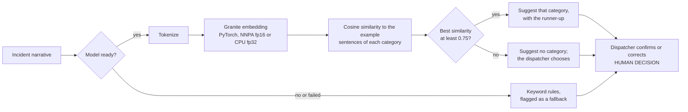

# AI pipeline

Two machine-learning components run inside the API process. Both are advisory and both degrade to deterministic fallbacks.

| Component | Framework | Pretrained or fitted | Data | Fallback |
|---|---|---|---|---|
| Incident classifier | PyTorch (`transformers`), [IBM Granite Embedding 30M English](https://huggingface.co/ibm-granite/granite-embedding-30m-english) | **Pretrained, not fine-tuned.** Nothing is trained on our data. | 3 hand-written example sentences per category (`PROTOTYPES` in `backend/app/embedding_classifier.py`), not training data | Keyword rules |
| ETA model | XGBoost (native `Booster` API) | **Fitted at start-up**, on the machine it runs on | A documented **synthetic** travel-time simulator (`backend/app/eta_model.py`) | Straight-line distance at an assumed speed |

Model: commit `9b5b096411652ec1189c68fcfb90d0a82c5b45af` of `ibm-granite/granite-embedding-30m-english` (Apache-2.0, 30.3M parameters,
384-dimension output, CLS pooling). The commit is pinned so the demo does not change underneath us.

## Classifier



- The model loads in a background thread at start-up. Until it is ready, or if it fails at any point, the keyword rules answer, the
  suggestion says so in `limitations`, and `GET /api/v1/health` reports `degraded`.
- The returned `confidence` is a softmax over category similarities. It orders and scales scores; it is **not a calibrated
  probability**, and the response says so. No priority is suggested.
- `modelVersion` names the backend that produced a suggestion, for example `...@9b5b096411+nnpa-float16` or `...+cpu-float32`.
- The abstain threshold (`EMBEDDING_MIN_SIMILARITY`, default 0.75) was chosen on development set A and checked on held-out set B
  (see [Evaluation](#evaluation)).

## ETA model

The training target comes from a simulator whose parameters are **assumptions, not measurements**: road circuity 1.3, speed that
rises with trip length, weekday rush-hour slowdown, night free-flow, and a turnout delay of about 60 s. The model therefore
demonstrates a gradient-boosted model in the live request path and a measured comparison with simple baselines. It says nothing
about accuracy on real roads. A deployment would train on AVL/CAD travel-time history or call a routing engine.

Features: straight-line distance, hour of day (UTC), and weekend flag. Training uses 6,000 simulated trips with an 80/20 split. The
estimator only orders units that already passed eligibility.

## Safety properties

These hold by construction and are enforced by tests in `backend/tests/`:

- **ML cannot change eligibility.** Eligibility is computed before ranking from status, staffing, credentials and equipment.
  An adversarial estimator that returns arbitrary ETAs, including 0 s, changes neither who is eligible nor whether an ineligible
  unit is ranked (`test_eta_model.py`, `test_recommendations.py`).
- **A suggestion never drives requirements.** Requirements come from the human-confirmed category, or the caller-reported one with
  a stated limitation. An unconfirmed model suggestion is ignored (`test_embedding_classifier.py`).
- **Failures degrade, not break.** A missing model, a load failure and a runtime failure each fall back and are reported as
  `degraded`; the accelerator falling back to CPU is covered by a test.
- **A human decides.** Assignment happens only through a recorded review; overriding an ineligible unit needs a reason and is audited.

## IBM Z: the NNPA accelerator

The LinuxONE image includes IBM's `torch_nnpa` plug-in, which registers an `nnpa` PyTorch device backed by the Telum NNPA
accelerator. On the project's VM, `torch_nnpa` reported `nnpa available: True` and `telum2 available: True`.

Only **fp16** weights reach the accelerator. With fp32 weights on the `nnpa` device, the profile shows 91.5% of the time in
`aten::mm` (127 of 139 ms) running on the CPU path, and latency is the same as CPU. The image therefore sets
`EMBEDDING_DEVICE=nnpa` and `EMBEDDING_DTYPE=float16`, and the encoder falls back to CPU fp32 automatically if the accelerator
cannot load.

## Evaluation

Measured on the project's LinuxONE VM (3 vCPUs), 2026-10-17 and 2026-10-18. Raw outputs are not committed; reproduce them with the
commands below.

**Classifier**: two sets of 26 hand-written synthetic narratives (13 categories, one narrative with obvious keywords and one
paraphrased per category). Set A is the development set we looked at and tuned the threshold on; set B was written before any model
output was seen and is only reported.

| Set | Keyword rules | Granite embedding | Obvious / paraphrased (embedding) |
|---|---|---|---|
| A (development) | 13/26 (50%) | 23/26 (88%) | 13/13 and 10/13 |
| B (held out) | 13/26 (50%) | 23/26 (88%) | 12/13 and 11/13 |

Raw similarity separates right from wrong suggestions poorly (wrong ones scored up to 0.734; correct ones had a median of 0.78). At
a threshold of 0.74 or 0.76, every suggestion made was correct on both sets (0.74: 18 of 26 answered on each set; 0.76: 16 on A and
14 on B). The chosen 0.75 lies between those two measured points and was not measured directly. With 52 narratives and 6 errors this
supports a sensible default; it is not a guarantee.

**Latency and parity** (classifier, one narrative at a time, 52 narratives; includes tokenization, embedding and similarity matching):

| Backend | p50 | p95 | Notes |
|---|---|---|---|
| CPU, fp32 | 158.8 ms | 207.8 ms | CPU build of PyTorch in IBM's image |
| NNPA, fp16 | 6.7 ms | 8.5 ms | 52 of 52 suggestions identical to CPU fp32; largest difference in top similarity 0.0027 |

Encoder only, milliseconds per narrative (`nnpa_check --sweep`):

| Config | Batch 1 | Batch 8 | Batch 32 |
|---|---|---|---|
| CPU fp32 | 131.8 | 200.7 | 209.6 |
| NNPA fp32 | 133.3 | 203.9 | 210.9 |
| NNPA fp16 | 2.9 | 1.2 | 2.3 |

NNPA fp16 embeddings matched CPU fp32 with a minimum cosine similarity of 0.9999 (16 narratives). The CPU baseline is the PyTorch CPU
build shipped in IBM's image on 3 vCPUs and appears poorly optimized for these shapes, so read the ratio as "versus that build", not
as a statement about CPUs in general. A single 8 x 384 by 384 x 384 linear layer ran in 0.076 ms on CPU and 0.011 to 0.013 ms on
the NNPA including the copy back to the host.

**ETA model** (synthetic data): trained on 4,800 simulated trips in 0.07 s on the VM; held-out mean absolute error was 108 s for
XGBoost, 188 s for a straight-line fit on distance, and 219 s for straight line at 40 km/h. The same numbers came out on an x86
laptop, so training is reproducible across the two architectures. Prediction takes 0.095 ms per unit (p50).

**Reproduce** (inside the image on the VM; see [deployment.md](deployment.md)):

```bash
docker run --rm dispatchz-api sh -c 'exec $PYTHON -m tools.classifier_eval --device nnpa --dtype float16'
docker run --rm dispatchz-api sh -c 'exec $PYTHON -m tools.classifier_eval'      # CPU fp32
docker run --rm dispatchz-api sh -c 'exec $PYTHON -m tools.nnpa_check --sweep --profile'
docker run --rm dispatchz-api sh -c 'exec $PYTHON -m tools.eta_eval'
```

## Planned, not implemented

- Demand forecasting (for example IBM Granite TinyTimeMixer) for the Planning module.
- Calibrated classifier confidence and a larger, independently labeled evaluation set.
- ETA from real travel-time history or a routing engine.
- Multi-incident optimization (for example OR-Tools); the API currently rejects `scope: multi_incident`.
