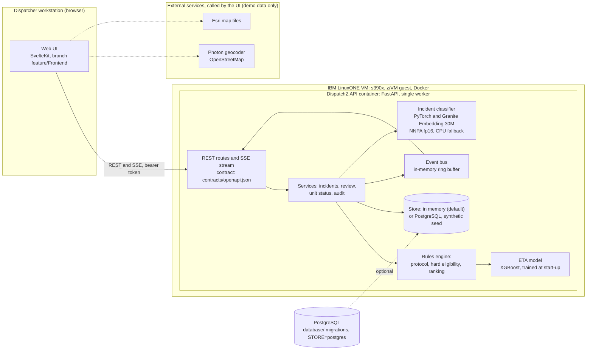
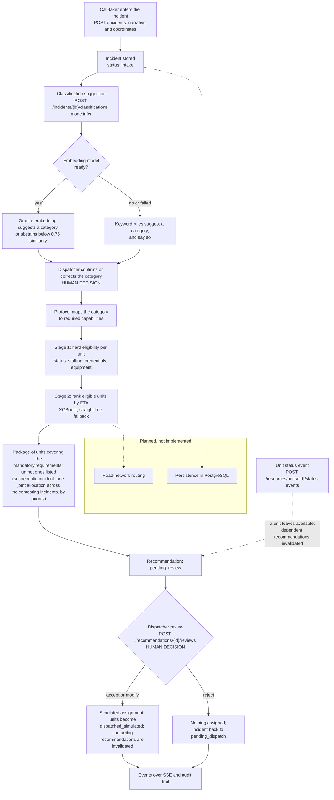
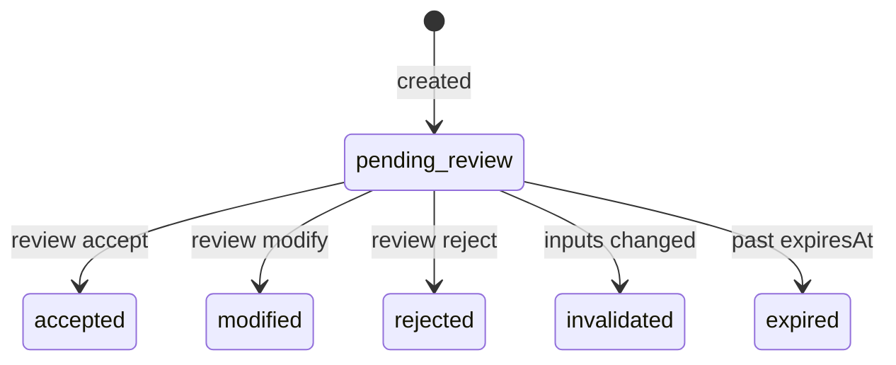

# Architecture

DispatchZ is human-in-the-loop decision support for emergency dispatch. It recommends which units to send, explains why, and
records what a dispatcher decides. It never dispatches anything: an accepted recommendation produces a **simulated** assignment.
All data is synthetic.

This document describes the system as it exists on `main` today. Planned work is labeled as planned.

## Components and where they run

| Component | Technology | Runs on | Status |
|---|---|---|---|
| API (REST + server-sent events) | FastAPI, Pydantic, Uvicorn (single worker) | Docker container on the LinuxONE VM; locally in a venv | Implemented: all 20 `mvp`-tier operations plus `listAuditEvents` |
| Rules engine (protocol, eligibility, ranking) | Pure Python, `backend/app/eligibility.py` | Inside the API | Implemented |
| Multi-incident allocator | Exact mixed-integer solve (SciPy/HiGHS), greedy fallback; `backend/app/multi_incident.py` | Inside the API | Implemented; see [ai-pipeline.md](ai-pipeline.md#multi-incident-allocation) |
| Incident classifier | PyTorch + IBM Granite Embedding 30M, keyword fallback | Inside the API container; model on the Telum NNPA accelerator in fp16, CPU fallback | Implemented; see [ai-pipeline.md](ai-pipeline.md) |
| ETA model | XGBoost, trained at start-up on a synthetic simulator, straight-line fallback | Inside the API | Implemented; synthetic training data |
| Store | In-memory, behind the `Store` interface in `backend/app/store.py` | Inside the API | Implemented; data is lost on restart |
| Event bus | In-process ring buffer | Inside the API | Implemented; single worker only |
| PostgreSQL schema and seed | Alembic, `psql` seed script in `database/` | Not deployed | Used by the API when `STORE=postgres` (see [Persistence](#persistence-status)) |
| Web UI | SvelteKit 2, Svelte 5, Leaflet | Developer machine | On branch `feature/Frontend`, not merged to `main` |
| Geocoding and map tiles | Photon (OpenStreetMap) and Esri tiles, called by the browser | External | Used by the UI for demo data only |

## System architecture

Solid lines exist today; dotted lines are external calls made by the browser, or planned.

## Processing flow

How an incident moves from intake to a recorded decision. The two **human decisions** are the only points where an incident's
category and the unit assignment are determined.

Machine learning only produces a *suggestion* (the category) and an *ordering* (ETA). Neither can make an ineligible unit eligible;
tests enforce this (see [ai-pipeline.md](ai-pipeline.md#safety-properties)).

## Decision logic

The protocol table (`backend/app/protocol.py`) is a **synthetic demo protocol**: it is not an adopted agency protocol or a statement
of any standard's minimums. Eligibility (`backend/app/eligibility.py`):

1. **Hard eligibility.** A unit is eligible only if it is `available`, its apparatus is not in maintenance or out of service, it is
   staffed to its minimum crew, it provides at least one mandatory capability, and it has no mandatory capability it nominally
   carries that is impaired (expired or unverified credential, equipment not ready). Equipment that is merely `limited` is not
   accepted. Capabilities come from active crew credentials and ready equipment, not from what a station owns.
2. **Ranking.** Only eligible units get a rank: ETA, then coverage impact, then call sign.
3. **Package.** A greedy cover of the mandatory requirements. Whatever cannot be filled is stated in `limitations`.

4. **Joint allocation (optional, `scope: multi_incident`).** When several incidents contest the same units, steps 1 and 2 run for
   each incident and an exact solver then assigns units across them: the highest-priority incident is staffed first, shortages fall on
   the lowest priority, and nothing ineligible can be chosen. The response is the asked-about incident's part of that one plan. See
   [ai-pipeline.md](ai-pipeline.md#multi-incident-allocation).

A dispatcher can override a recommendation (an ineligible or non-recommended unit) only with an `overrideReason`; it is recorded as
an override. A unit that is not `available` right now can never be assigned.

## Lifecycles

Incident status: `intake` → `pending_dispatch` → `recommendation_ready` → `dispatched_simulated` → `on_scene_simulated` → `resolved`,
or `cancelled`. Invalid transitions return `409 INVALID_STATE_TRANSITION`.

A recommendation is invalidated when the incident's category, narrative or location changes, when the incident is cancelled or
resolved, when a newer recommendation supersedes it, when a unit in its recommended package is assigned elsewhere, or when such a
unit leaves `available`. It expires after `RECOMMENDATION_TTL_SECONDS` (default 300).

## Events

`GET /api/v1/events/stream` is Server-Sent Events with replay from `Last-Event-ID`. Emitted: `incident.created`, `incident.updated`,
`unit.status_changed`, `recommendation.created`, `recommendation.invalidated`, plus `stream.heartbeat` (every 15 s) and
`stream.resync_required`. `coverage.gap_detected` is in the contract but is not emitted. Ids are a single in-process sequence, so a
restart makes older `Last-Event-ID` values trigger `stream.resync_required`.

## Persistence status

The API runs on one of two `Store` implementations, chosen by `STORE` (see `.env.example`):

- `memory` (default): everything is lost on restart; `InMemoryStore` in `backend/app/store.py`.
- `postgres`: `PostgresStore` in `backend/app/pg_store.py`, using `DATABASE_URL`. Apply the Alembic migrations in `database/` first
  (`alembic upgrade head`). An empty database is seeded with the stand-in seed on start-up and is never re-seeded afterwards, so data
  survives restarts; `POST /api/v1/admin/demo/reset` (demo mode) restores the seed.

Layout: reference data (facilities, capabilities, personnel, credentials, apparatus, equipment, units and their crews) uses the
relational tables from migrations `0001`/`0002`, written and read by `backend/app/pg_resources.py`. What the API writes at run time
(incidents, classifications, recommendations, reviews, unit status events, audit) is in the `api_*` tables from `0003`, each row holding
the contract model as JSON next to its lookup columns. The `0001` tables `incident`, `review`, `audit` and the like are not used by the
API: their constraints cannot hold the contract's shapes. Idempotency keys and the event stream's replay buffer stay in process memory.

`database/seed.py` (the Seattle fire scenario) still loads on top of `0002`, but it has no crew links, credentials, apparatus or
equipment, and its capability codes and categories are not the contract's, so the API shows its units as ineligible. The stand-in seed
is the one the API and its tests use. Known gaps between the Seattle seed and the contract:

| Topic | Database seed | API and contract |
|---|---|---|
| Crew and equipment | None in the Seattle seed | The rules engine derives capabilities from crew credentials and equipment readiness |
| Incident categories | Free text, for example `vegetation_fire` | The contract's enumeration (`structure_fire`, `wildland_fire`, ...) |
| Capability codes | `STRUCTURAL_FIRE`, `LADDER_RESCUE`, ... | `CAP-*` identifiers used by the protocol |

Testing against PostgreSQL: set `TEST_STORE=postgres` and `TEST_DATABASE_URL` and run `pytest` in `backend/`; the whole suite then runs on
`PostgresStore`. This **resets and truncates that database**, so point it at a scratch database.

## Location handling

The API stores a latitude and longitude (and an optional address string) supplied by the client; it does no geocoding. The UI
geocodes in the browser through Photon and draws Esri tiles, which is acceptable for synthetic data only. Contract changes the
frontend work proposes (optional point, server-side resolution, location provenance) are described in
`docs/location-intake.md` on `feature/Frontend` and need explicit approval; see [development.md](development.md#contract-first-workflow).

## Security and privacy posture

Implemented: bearer-token authentication with fixed **demo** tokens (not production authentication), role checks that match the
contract, required `Idempotency-Key` on state-changing calls, an audit trail of state changes, and `isSynthetic: true` required on
every incident. In the LinuxONE deployment the API port is published on the VM's localhost only and reached through an SSH tunnel.

Not implemented: a real identity provider, TLS termination, encryption at rest, rate limiting, and multi-tenant isolation beyond the
`tenantId` filter on the audit trail.

## Planned work

Planning and Insights modules (demand forecasting, gap detection, leadership reports; contract tier `future`),
road-network routing, and a calibrated
classifier confidence. See [mvp-plan.md](mvp-plan.md) for the original scope and tiers.
