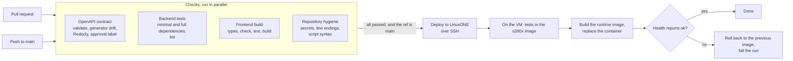

# CI/CD

GitHub Actions validates every pull request and every push to `main`. A push to `main` that passes every check is then deployed to
the LinuxONE VM. The whole pipeline is one workflow, [`.github/workflows/ci.yml`](../.github/workflows/ci.yml), so the deploy job
cannot start unless the checks succeeded.

## Pipeline



Pull requests run the checks only. They never deploy and never see the deploy secrets.

## Jobs

| Job (the name GitHub shows) | What it checks | Fails when |
|---|---|---|
| **OpenAPI contract** | `scripts/check_contract.py` validates `contracts/openapi.json` and compares it with the output of `scripts/gen_openapi.py`; Redocly lints it; on pull requests, a contract change needs a label | The file is invalid, was edited by hand or without regenerating, has lint errors (the 15 "unused component" warnings are expected: SSE payload schemas are not referenced by a response), or a PR changes the contract without the `contract-approved` label |
| **Backend tests (minimal)** | `pytest` on Python 3.12 without xgboost or torch, plus a lint for syntax errors and undefined names | A test fails, or the code does not import on a clean checkout |
| **Backend tests (full)** | The same with xgboost, so the ETA model tests run too | As above |
| **Frontend build** | `npm ci`, regenerated API types match the committed ones, `svelte-check`, `vitest`, production build | Any of those fails. **Skipped with a notice** when there is no `frontend/package.json` on the branch (the UI is still on `feature/Frontend`) |
| **Repository hygiene** | Shell scripts parse; no key files, `.env` or private keys are tracked; files that must be LF are LF | A secret or CRLF is committed |
| **Deploy to LinuxONE** | See below | The VM tests fail, the image does not build, or the API does not become healthy |

What CI deliberately does not cover: the Docker image, the Granite embedding model on the NNPA accelerator and the XGBoost model on
big-endian s390x. They cannot run on a GitHub-hosted x86 runner, so they are tested on the VM as the first step of the deploy.

### The contract approval label

[`CLAUDE.md`](../CLAUDE.md) requires explicit human approval before the API contract changes. The check cannot judge whether an
amendment is sensible; it makes sure nobody changes the contract without a person having looked. A pull request that touches
`contracts/openapi.json` or `scripts/gen_openapi.py` fails until a reviewer adds the label `contract-approved`. The label must be
added by a human reviewer after the amendment is approved, not by the author to get the build green.

## Deploy

[`scripts/deploy_vm.sh`](../scripts/deploy_vm.sh) is the same script a developer runs by hand. In CI it:

1. Copies the checked-out commit to the VM over SSH.
2. Builds the `test` image on the VM and runs the whole suite there, on s390x with torch, xgboost and the Granite model.
3. Builds the runtime image and keeps the previous one as `dispatchz-api:previous`.
4. Replaces the container and waits up to two minutes for `GET /api/v1/health` to report `"status":"ok"`.
5. If the build or the health check fails: exits non-zero, shows the container logs and starts the previous image again. If the
   tests fail, the running container is not touched at all.

The commit is recorded as the image label `org.opencontainers.image.revision` and in `~/dispatchz/DEPLOYED_REF` on the VM, so
`docker inspect dispatchz-api` and `cat ~/dispatchz/DEPLOYED_REF` tell you which commit is running. Deploys never overlap: they
share one concurrency group and queue instead of canceling each other.

Where the deployed API can be reached is a separate decision; see [Seeing the deployment](#seeing-the-deployment).

## One-time setup (a repository admin does this)

### 1. A dedicated deploy key

Use a key made only for CI, not the key IBM issued for the VM, so it can be revoked on its own. On your machine:

```bash
ssh-keygen -t ed25519 -N "" -C "dispatchz-ci" -f dispatchz_deploy
# Authorize it on the VM (use your existing key to connect):
ssh -i /path/to/ibm-key.pem linux1@<vm-ip> 'cat >> ~/.ssh/authorized_keys' < dispatchz_deploy.pub
# Optional but recommended: the VM's host key, so CI does not trust whatever answers on that IP.
ssh-keyscan -t ed25519 <vm-ip>
```

### 2. Repository secrets

Settings → Secrets and variables → Actions → New repository secret (or the same under Environments → `linuxone`):

| Secret | Value |
|---|---|
| `VM_SSH_KEY` | The contents of the private file `dispatchz_deploy` |
| `VM_HOST` | `linux1@<vm-ip>` |
| `VM_KNOWN_HOSTS` | Optional. The `ssh-keyscan` output from step 1 |

Then delete the local `dispatchz_deploy` file or keep it somewhere safe. Until `VM_SSH_KEY` and `VM_HOST` exist, the deploy job
finishes with a warning and a summary saying it was skipped; the checks still run.

### 3. Branch protection, so a failed commit cannot reach `main`

The workflow reports results; it cannot block a push by itself. Settings → Branches → Add rule for `main`:

- Require a pull request before merging.
- Require status checks to pass: select **OpenAPI contract**, **Backend tests (minimal)**, **Backend tests (full)**, **Frontend build**
  and **Repository hygiene**. Do not select the deploy job.
- Optionally require one approving review. For `contracts/openapi.json`, a `CODEOWNERS` entry naming the contract owner makes that
  review mandatory (the repository does not have one yet because it needs the owner's GitHub handle).

Without this rule, anyone can still push straight to `main`; CI then runs and the deploy is skipped on failure, but the bad commit
is already on `main`.

## Running the checks locally

```bash
python scripts/check_contract.py                                   # needs: pip install openapi-spec-validator
npx @redocly/cli@2.64.1 lint contracts/openapi.json
(cd backend && python -m pytest -q)                                # needs: pip install -r backend/requirements-test.txt [xgboost]
ruff check --select E9,F63,F7,F82,F811 backend scripts             # needs: pip install ruff
(cd frontend && npm ci && npm run gen:types && npm run check && npm test && npm run build)
```

## Seeing the deployment

The API container listens on the VM's `localhost:8000` only, on purpose: the bearer tokens are fixed demo tokens, so the API must
not face the internet. Teammates reach it through an SSH tunnel ([deployment.md](deployment.md#access)). The GitHub **Deployments**
page (repository sidebar) and the run summary show which commit was deployed and when.

If the team wants a URL that anyone can open, that is a security decision to take explicitly (a reverse proxy with TLS and real
authentication, or a read-only demo mode), not something the pipeline should do quietly.

## Limitations and known risks

- **Not yet run on GitHub.** The workflow passes `actionlint`, the check commands were run locally, and the deploy script's
  failure and rollback paths were exercised against stubbed `docker` and `curl`. The first real run on GitHub and the first
  deploy from a runner to the VM are unconfirmed. Expect to fix small things on the first run.
- **The runner must reach the VM.** GitHub-hosted runners connect to the VM's public SSH port. If the LinuxONE Community Cloud
  restricts inbound addresses, the deploy step fails at the `scp`; the fix is a self-hosted runner on a machine that can reach it.
- **The VM can change.** Community Cloud instances are time-limited and a new one has a new address and host key. Update `VM_HOST`,
  `VM_KNOWN_HOSTS` and the authorized key.
- **Only the API is deployed.** The web UI is not on `main`. When it is, deploying it (for example serving the static build) is a
  separate addition.
- **A short outage per deploy.** The old container stops before the new one starts. That is acceptable for a demo; a rolling
  swap would need a second port and a proxy.
- **Rollback is one level deep.** `dispatchz-api:previous` is the image that was running before the latest deploy.
