# CI/CD

GitHub Actions validates every pull request and every push to `main`. A push to `main` that passes every check is then deployed to
the LinuxONE VM. The whole pipeline is one workflow, [`.github/workflows/ci.yml`](../.github/workflows/ci.yml), so the deploy job
cannot start unless the checks succeeded.

## Pipeline

```mermaid
flowchart LR
    PR["Pull request"] --> C
    PUSH["Push to main"] --> C
    subgraph C["Checks, run in parallel"]
        K["OpenAPI contract<br/>validate, generator drift,<br/>Redocly, approval label"]
        B["Backend tests<br/>minimal and full dependencies,<br/>lint"]
        F["Frontend build<br/>types, check, test, build"]
        N["Containers<br/>compose stack smoke test,<br/>s390x web image"]
        H["Repository hygiene<br/>secrets, line endings,<br/>script syntax"]
    end
    C -->|"all passed, and the ref is main"| D["Deploy to LinuxONE<br/>over SSH"]
    D --> I["On the runner: web image for s390x"]
    I --> T["On the VM: tests in the s390x image"]
    T --> R["Build the API image,<br/>docker compose up with the commit tag"]
    R --> W{"Healthy, and running<br/>this commit?"}
    W -->|yes| P["Probe the public URL<br/>from the runner"]
    W -->|no| RB["Restore the previous release,<br/>fail the run"]
```



Pull requests run the checks only. They never deploy and never see the deploy secrets.

## Jobs

| Job (the name GitHub shows) | What it checks | Fails when |
|---|---|---|
| **OpenAPI contract** | `scripts/check_contract.py` validates `contracts/openapi.json` and compares it with the output of `scripts/gen_openapi.py`; Redocly lints it; on pull requests, a contract change needs a label | The file is invalid, was edited by hand or without regenerating, has lint errors (the 15 "unused component" warnings are expected: SSE payload schemas are not referenced by a response), or a PR changes the contract without the `contract-approved` label |
| **Backend tests (minimal)** | `pytest` on Python 3.12 without xgboost or torch, plus a lint for syntax errors and undefined names | A test fails, or the code does not import on a clean checkout |
| **Backend tests (full)** | The same with xgboost, so the ETA model tests run too | As above |
| **Frontend build** | `npm ci`, regenerated API types match the committed ones, `svelte-check`, `vitest`, production build | Any of those fails. Skipped with a notice on a branch that has no `frontend/package.json` |
| **Containers** | Builds the Compose stack on the runner (API on a stock Python image via `compose.local.yml`; the web image and nginx are the deployed ones) and checks the app shell, the single-page fallback, the API through the proxy, `401` without a token, `403` on the admin paths (the demo reset is the one exception, POST with the admin token), and that the proxy still reaches the API after its container is recreated. Also builds the web image for `linux/s390x` | Any check fails, an image does not build, or the stack is not healthy |
| **Repository hygiene** | Shell scripts parse; no key files, `.env` or private keys are tracked; files that must be LF are LF | A secret or CRLF is committed |
| **Deploy to LinuxONE** | See below | The VM tests fail, an image does not build, or the stack does not become healthy on the commit just built |

What CI deliberately does not cover: the API image on IBM's base, the Granite embedding model on the NNPA accelerator and the XGBoost model on
big-endian s390x. They cannot run on a GitHub-hosted x86 runner, so they are tested on the VM as the first step of the deploy.

### The contract approval label

[`CLAUDE.md`](../CLAUDE.md) requires explicit human approval before the API contract changes. The check cannot judge whether an
amendment is sensible; it makes sure nobody changes the contract without a person having looked. A pull request that touches
`contracts/openapi.json` or `scripts/gen_openapi.py` fails until a reviewer adds the label `contract-approved`. The label must be
added by a human reviewer after the amendment is approved, not by the author to get the build green.

## Deploy

[`scripts/deploy_vm.sh`](../scripts/deploy_vm.sh) is the same script a developer runs by hand (with `--dev` it deploys a separate test stack; see
[deployment.md](deployment.md#deploy)). In CI it:

1. Builds the web image for `linux/s390x` on the runner (the Node stage runs natively; no emulation) and packs only the API's build
   context (`backend/`, the contract, `compose.yml`) from the tracked files, then sends both to the VM over SSH.
2. Builds the `test` image on the VM and runs the whole suite there, on s390x with torch, xgboost and the Granite model.
3. Builds the API image and loads the web image, both tagged with the first 12 characters of the commit, and checks both are `s390x`.
4. Runs `docker compose up -d --wait` with that tag, then waits up to two minutes for `GET /api/v1/health` **through the web proxy**
   to report `"status":"ok"` and for `/` to serve the app.
5. Checks that the running `api` and `web` containers carry this commit in their `org.opencontainers.image.revision` label.
6. On success: records the release, deletes images older than the previous release, and deletes the build bundle.
   On failure of the build or the health check: exits non-zero, prints the container logs and starts the previous release again. If the
   tests or a build fail, the running stack is not touched at all.
7. Back on the runner: requests `/api/v1/health` over the VM's public address. A failure here is a warning, not a failed deploy.

`~/dispatchz/DEPLOYED_REF` and `DEPLOYED_TAG` on the VM tell you which commit is running (`docker compose -p dispatchz ps` shows the
containers). They change only after the new release is healthy and verified, so after a rollback they still name what is really running.
Deploys never overlap: they share one concurrency group and queue instead of canceling each other, and the script takes a lock on the VM.

Where the deployed app can be reached is described in [deployment.md](deployment.md#public-access).

## One-time setup (a repository admin does this)

### 1. A dedicated deploy key

Use a key made only for CI, not the key IBM issued for the VM, so it can be revoked on its own. On your machine:

```bash
ssh-keygen -t ed25519 -N "" -C "dispatchz-ci" -f dispatchz_deploy
# Authorize it on the VM (use your existing key to connect):
ssh -i /path/to/ibm-key.pem linux1@<vm-ip> 'cat >> ~/.ssh/authorized_keys' < dispatchz_deploy.pub
# Optional but recommended: the VM's host key, so CI does not trust whatever answers on that IP.
ssh-keyscan -t ed25519 <vm-ip>
```

### 2. Repository secrets

Settings → Secrets and variables → Actions → New repository secret (or the same under Environments → `linuxone`):

| Secret | Value |
|---|---|
| `VM_SSH_KEY` | The contents of the private file `dispatchz_deploy` |
| `VM_HOST` | `linux1@<vm-ip>` |
| `VM_KNOWN_HOSTS` | Optional. The `ssh-keyscan` output from step 1 |

Optionally, a repository **variable** (not a secret) `VM_WEB_PORT`, if the web UI is published on a port other than 80; the deploy's
final public-URL probe uses it.

Then delete the local `dispatchz_deploy` file or keep it somewhere safe. Until `VM_SSH_KEY` and `VM_HOST` exist, the deploy job
finishes with a warning and a summary saying it was skipped; the checks still run.

### 3. Branch protection, so a failed commit cannot reach `main`

The workflow reports results; it cannot block a push by itself. Settings → Branches → Add rule for `main`:

- Require a pull request before merging.
- Require status checks to pass: select **OpenAPI contract**, **Backend tests (minimal)**, **Backend tests (full)**, **Frontend build**,
  **Containers** and **Repository hygiene**. Do not select the deploy job.
- Optionally require one approving review. For `contracts/openapi.json`, a `CODEOWNERS` entry naming the contract owner makes that
  review mandatory (the repository does not have one yet because it needs the owner's GitHub handle).

Without this rule, anyone can still push straight to `main`; CI then runs and the deploy is skipped on failure, but the bad commit
is already on `main`.

## Pinned versions

Nothing the pipeline or the VM build depends on is allowed to change unless a pull request changes it on purpose.

| What | Pinned by | Where |
|---|---|---|
| CI runner image | `ubuntu-24.04` | `runs-on` in the workflow |
| GitHub Actions | Full commit SHA, with the version in a comment | `uses:` lines in the workflow |
| Python and Node in CI | Exact patch versions (3.12.15, 22.23.3) | `env:` in the workflow |
| Python packages in CI | Exact versions for the whole dependency tree, resolved against the IBM image's versions | `.github/pins/minimal.lock`, `full.lock` |
| Frontend packages | Lockfile, installed with `npm ci` | `frontend/package-lock.json` |
| Node and nginx images of the web image | Image digest (multi-architecture index) | `NODE_IMAGE`, `NGINX_IMAGE` in `frontend/Dockerfile` |
| API packages on the VM (FastAPI, Pydantic, Starlette, Uvicorn, pytest, ...) | Exact versions of what passed on s390x | `backend/constraints.txt`, applied by the Dockerfile |
| IBM's base image (PyTorch, `torch_nnpa`, XGBoost, ...) | Image digest, not the moving `:latest` tag | `ARG BASE_IMAGE` in `backend/Dockerfile` |
| Embedding model weights | Hugging Face revision | `MODEL_REVISION` in `backend/app/embedding_classifier.py` |
| Contract linter | Exact version | the Redocly line in the workflow |

CI installs the lock with `pip install --no-deps` and then runs `pip check`, so a dependency missing from the lock fails the job
instead of being fetched at whatever version is newest.

What is still not pinned: the packages that come preinstalled on the GitHub runner image (git, curl, ssh, Docker, Node for `npx`),
which GitHub updates weekly inside the `ubuntu-24.04` label, and the npm dependencies of the Redocly CLI, which `npx` resolves from
ranges. Both have been stable; if one ever breaks the contract job, pin it then.

## Updating pinned versions

Do these in a pull request. CI then runs the whole suite against the new versions before anything reaches `main`.

- **Runner, Python or Node in CI:** edit `runs-on` or `env:` in the workflow.
- **An action:** pick a tag, then use its commit SHA and keep the version comment.
  `git ls-remote --tags https://github.com/actions/checkout 'refs/tags/v6*'` (for an annotated tag use the SHA on the `^{}` line).
- **A CI Python package:** edit `.github/pins/minimal.in` or `full.in`, run `pip install uv==0.13.1` and `python scripts/lock_ci.py`,
  and commit the changed `.lock` files. The script resolves for Linux and Python 3.12 whatever machine you run it on.
- **A package on the VM (for example FastAPI):** edit `backend/constraints.txt`, then try it from your branch with
  `bash scripts/deploy_vm.sh --dev` (it does not touch the demo) or read the PR's CI result; the Docker build and the full test suite on s390x are the real check. Run `scripts/lock_ci.py`
  too, because the CI locks are resolved against that file.
- **IBM's base image:** on the VM, `docker pull` the new image, read its digest with
  `docker image inspect --format '{{index .RepoDigests 0}}' <image>`, put it in the Dockerfile, refresh
  `.github/pins/ibm-base-image.txt` from `pip list --format=freeze` inside the image, update `backend/constraints.txt` if needed,
  and rerun `scripts/lock_ci.py`.
- **Frontend packages:** `npm install <pkg>@<version>` in `frontend/` and commit `package-lock.json`.
- **The Node or nginx image:** `docker buildx imagetools inspect node:22-bookworm-slim` (or `nginx:stable-alpine`) prints the index digest;
  put it in the `ARG` in `frontend/Dockerfile`. The `Containers` job builds it before it can reach `main`.

## Running the checks locally

```bash
pip install --no-deps -r .github/pins/full.lock                    # the exact CI environment (use a virtual environment)
python scripts/check_contract.py
npx @redocly/cli@2.64.1 lint contracts/openapi.json
(cd backend && python -m pytest -q)
ruff check --select E9,F63,F7,F82,F811 backend scripts
(cd frontend && npm ci && npm run gen:types && npm run check && npm test && npm run build)
docker compose -f compose.yml -f compose.local.yml up -d --build --wait   # the Containers job; then: down
```

## Seeing the deployment

The web UI is published on the VM's port 80 over HTTP, so anyone who can reach the VM's address can open it; the API itself is
published only on the VM's loopback (reach it with an SSH tunnel, [deployment.md](deployment.md#public-access)). The bearer tokens are fixed
demo tokens, so the app is a public demo of synthetic data, not a protected service; the deployment document lists the controls.
The GitHub **Deployments** page (repository sidebar) and the run summary show which commit was deployed and when, and whether the
public address answered.

## Limitations and known risks

- **Rollback was exercised on the dev stack only.** On 2026-10-18 a deliberately crashing release deployed with `--dev` was rejected and the
  previous release restored (details in [deployment.md](deployment.md#verification-status)). It has not been run against the shared stack.
- **Pins go stale.** Pinned versions do not receive security fixes by themselves, and nothing updates them automatically (Dependabot was
  tried and removed: the project is a short event, and automatic version bumps near a deadline are risk without benefit). If the project
  continues, follow "Updating pinned versions" or re-add `.github/dependabot.yml` for the actions and frontend packages.
- **The runner must reach the VM.** GitHub-hosted runners connect to the VM's public SSH port. If the LinuxONE Community Cloud
  restricts inbound addresses, the deploy step fails at the `scp`; the fix is a self-hosted runner on a machine that can reach it.
- **The VM can change.** Community Cloud instances are time-limited and a new one has a new address and host key. Update `VM_HOST`,
  `VM_KNOWN_HOSTS` and the authorized key.
- **No database in the stack.** The API runs on its in-memory store; see [deployment.md](deployment.md#architecture) for what adding PostgreSQL involves.
- **No HTTPS.** Plain HTTP on the VM's address until a domain and certificate exist.
- **The Compose plugin on the VM is a prerequisite** that the deploy checks for but cannot install.
- **A short outage per deploy.** Compose replaces the containers in place. That is acceptable for a demo; a rolling
  swap would need a second port and a proxy in front.
- **Rollback is one level deep.** The release named in `PREVIOUS_TAG` is the only older one kept.
- **No registry.** Images are built where they run (API on the VM, web on the runner) and the web image travels over SSH. A registry
  such as GHCR would let the VM pull the web image, but the API image cannot be built on a GitHub runner (IBM's base image is s390x-only
  and on IBM's registry), so a registry alone would not remove the VM build.
