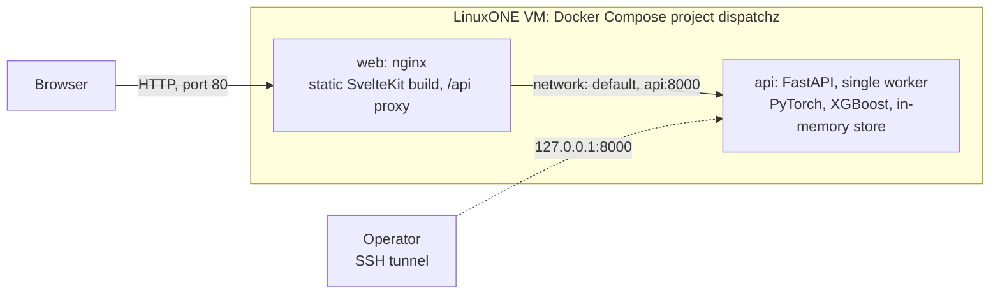

# Deployment on IBM LinuxONE

DispatchZ runs as a two-container Docker Compose stack on a LinuxONE Community Cloud VM: **web** (nginx, serves the UI and proxies
`/api`) and **api** (FastAPI with the ML components). This document covers the images, the deploy, public access, rollback and
verification. For local development without Docker see [development.md](development.md); for the pipeline see [ci-cd.md](ci-cd.md).

## Target environment

Observed on the project's VM (from `lscpu`, `/etc/os-release` and the platform check):

| Item | Value |
|---|---|
| Architecture | `s390x`, big-endian |
| Hypervisor | z/VM 7.3.0 (full virtualization) |
| CPU and memory | 3 CPUs at 5508 MHz (machine type 9175), about 7 GB RAM, 50 GB disk |
| Operating system | Ubuntu 24.04.5 LTS |
| Docker | 29.8.0 (podman is not installed) |
| Docker Compose plugin | Compose v5.5.1 and buildx v0.37.1 (checked 2026-10-18); the deploy script still checks for it |
| Accelerator facility | `nnpa` flag present; `torch_nnpa` reports `nnpa available: True` and `telum2 available: True` |

The VM is requested through the [LinuxONE Community Cloud](https://linuxone.cloud.marist.edu/) (event code `SSF2026` gives an instance
sized for ML work). The VM has limited memory and disk and a restricted network, so the design keeps images few and small, keeps two
releases of each, and avoids needing any registry other than IBM's.

## Architecture



| Service | Image | Published | Notes |
|---|---|---|---|
| `web` | `dispatchz-web:<commit>` (nginx on Alpine, the UI baked in) | `0.0.0.0:80` | The only public port. Blocks `/api/v1/admin/*`, streams the event stream unbuffered |
| `api` | `dispatchz-api:<commit>` (IBM ML base image plus our packages) | `127.0.0.1:8000` | Reachable by the web service over the Compose network; on the host only through the VM's loopback |

There is no database service. The API's default store is in memory, which is the configuration that has been deployed and verified on
the VM. PostgreSQL support exists in the code (`STORE=postgres`, see [architecture.md](architecture.md#persistence-status)) but is not
part of the stack; adding it means a `db` service with a volume, its password in the VM-only `.env`, running the Alembic migrations on
start, and confirming the PostgreSQL driver installs on s390x. The data is synthetic and re-seeded on every start, so nothing is lost
by restarting.

The browser calls `/api/...` on the origin it loaded the page from (`baseUrl: ''` in `frontend/src/lib/api/client.ts`), so no API URL
is configured anywhere and nothing can point at the visitor's own `localhost`.

## The images

### API (`backend/Dockerfile`)

Built **on the VM**, because the base image, `registry.linuxone.cloud.marist.edu/l1cc/jupyterlab-image-s390x` (pinned by digest),
exists only for s390x on IBM's registry. It already provides PyTorch, IBM's `torch_nnpa` plug-in, `libzdnn`, XGBoost and scikit-learn,
which have no s390x wheels on PyPI. Our layer adds only the API's own dependencies at the versions in `backend/constraints.txt`, and
pip is prevented from changing IBM's libraries; a conflict fails the build. See [Pinned versions](ci-cd.md#pinned-versions).

| Dockerfile target | Purpose |
|---|---|
| `test` | Adds test dependencies and the tests, and runs the full suite inside the image |
| `runtime` (default) | The API: FastAPI on port 8000, one worker, health check. No test code, no test packages. The build tries to pre-download the model; if that fails it is downloaded at first start |

The runtime image sets `CLASSIFIER=embedding`, `EMBEDDING_DEVICE=nnpa`, `EMBEDDING_DTYPE=float16` and `ETA_MODEL=xgboost`, and runs as the
base image's non-root user.

### Web (`frontend/Dockerfile`)

Multi-stage: a Node stage runs `npm ci` and `npm run build`, then only the static output is copied into `nginx:stable-alpine`. Node and
the frontend's dev dependencies are not in the final image. Both base images are pinned by digest.

It is built **on the CI runner** (or your machine), not on the VM: the Node stage is `FROM --platform=$BUILDPLATFORM`, so it runs
natively on the builder, and the final stage only copies files, so `docker buildx build --platform linux/s390x` needs no emulation. The
result is a genuine `linux/s390x` image, sent to the VM with `docker save | ssh ... docker load`. This keeps Node and Docker Hub off
the VM's requirements: the VM pulls nothing from the internet for the web image.

### Context hygiene

The API's build context is an allowlist (`.dockerignore`: `backend/` and `contracts/openapi.json` only), and the deploy ships exactly
that, taken from tracked files, so `.git`, `.env`, keys and the frontend can never reach a layer. No secrets are passed as build
arguments or baked into either image.

## Deploy

Pushes to `main` deploy automatically once the checks pass ([ci-cd.md](ci-cd.md)). The deploy is
[`scripts/deploy_vm.sh`](../scripts/deploy_vm.sh); CI runs the same script a developer can run by hand.

| Step | Where | If it fails |
|---|---|---|
| Build the web image for `linux/s390x` | CI runner | Nothing was sent; nothing changed |
| Pack the API build context | CI runner | Same |
| Run the test suite in the s390x test image | VM | Stops; the running stack is not touched |
| Build the API image, load the web image, check both are `s390x` | VM | Stops; the running stack is not touched |
| `docker compose up -d --wait` with the new tag, then wait for `status: ok` through the web proxy and for `/` to serve the app | VM | The previous release is restored; the run fails |
| Check both running containers carry the commit that was just built | VM | Same |
| Record `DEPLOYED_TAG`, `DEPLOYED_REF`; delete images older than the previous release; delete the bundle | VM | |
| Fetch `/api/v1/health` from the CI runner over the public address | CI runner | Warning only (usually a firewall, see below) |

By hand (needs Docker with buildx on your machine, and bash):

```bash
export VM_KEY="/path/to/private-key.pem" VM_HOST="linux1@<vm-ip>"
bash scripts/deploy_vm.sh --dev        # your own stack; add --no-tests to skip the test image
bash scripts/deploy_vm.sh --yes        # replaces the SHARED stack; normally CI does this
```

`--dev` builds the working tree you run it from as a separate Compose project, `dispatchz-dev`, with the web UI on VM port 8001 and the
API on 9001, both bound to the VM's loopback, and its own images and directory. It never touches the shared stack, its images or its
release records, and it has the same rollback. Reach it with a tunnel:

```bash
ssh -i /path/to/private-key.pem -L 8001:localhost:8001 linux1@<vm-ip>      # then use http://localhost:8001
```

Several people can each have a stack: give each their own `DEV_NAME` and `DEV_PORT`, for example
`DEV_NAME=alex DEV_PORT=8002 bash scripts/deploy_vm.sh --dev`. Remove one you are done with
(`cd ~/dispatchz-dev && docker compose -p dispatchz-dev down`); the VM has about 7 GB of memory and each API loads its own model.

### What lives on the VM

```text
~/dispatchz/
  compose.yml        the Compose file of the running release
  .env               optional, hand-made, mode 600: WEB_PORT, WEB_BIND, DEMO_MODE (never written by CI)
  DEPLOYED_TAG       image tag of the running release (the first 12 characters of the commit)
  DEPLOYED_REF       the full commit of the running release
  PREVIOUS_TAG       the release before it, kept as the rollback target
```

Nothing else: the source bundle is extracted into a temporary directory and removed when the script ends, whatever the outcome. The
first deploy with this layout also removes the old copy of the repository that earlier versions of the script left in `~/dispatchz`,
and the single `dispatchz-api` container they started.

### Rollback and recovery

- **Automatic:** a release that does not become healthy is replaced by `PREVIOUS_TAG`, using the previous `compose.yml`, and the run
  fails. `DEPLOYED_TAG` and `DEPLOYED_REF` change only after the new release is healthy and verified, so they always name what is running.
- **By hand**, to go back one release (the previous images are still on the VM):

  ```bash
  cd ~/dispatchz
  DISPATCHZ_TAG="$(cat PREVIOUS_TAG)" docker compose -p dispatchz up -d --no-build --wait
  ```

  A manual rollback leaves the record files naming the newer release; the next deploy overwrites them.
- **Older than one release back:** re-run the workflow for that commit from the Actions tab ("Run workflow" on `main` deploys the
  current `main`; to deploy an older commit, revert on `main`).
- **A short outage per deploy** is expected: Compose replaces the containers in place.

## Verify

On the VM:

```bash
cd ~/dispatchz
docker compose -p dispatchz ps                     # both services "healthy"
cat DEPLOYED_REF                                   # the commit that is running
curl -s localhost/api/v1/health                    # through the web proxy
curl -s localhost:8000/api/v1/health               # directly
```

Expect `"architecture":"s390x"` and `"syntheticDataOnly":true`. The status reads `degraded` for the first seconds while the models
load, then `ok`; the `inference` component names the classifier (including its backend, such as `+nnpa-float16`) and the ETA model.
A suggestion's `modelVersion` also states the backend that produced it.

From your own computer, in a browser or with curl: `http://<vm-ip>/` should show the app and `http://<vm-ip>/api/v1/health` the JSON above.

## Public access

The web container is published on `0.0.0.0:80` over plain HTTP. Whether it is reachable from outside the VM depends on layers this
repository cannot see or change:

1. **Docker** publishes the port (done by `compose.yml`). Note that Docker inserts its own firewall rules, so `ufw` rules do not
   block a published port; the check in step 3 is the only reliable one.
2. **The VM's own firewall.** The project's VM has no `ufw`; its `iptables` INPUT chain accepts only ports 22 and 38888 and rejects the
   rest, but traffic to a published container port is forwarded (DNAT) and does not pass that chain. Confirmed on 2026-10-18: port 80 answered from
   outside despite it. Check with `sudo iptables -S`; if a rule does block it, `sudo iptables -I INPUT -p tcp --dport 80 -j ACCEPT`.
3. **The cloud network in front of the VM.** The LinuxONE Community Cloud may filter inbound ports; on this instance port 80 is open. If a
   future instance blocks it, either open it or set `WEB_PORT` in `~/dispatchz/.env` to a port that is open (for example `WEB_PORT=8080`), run the deploy again, and set the
   GitHub Actions variable `VM_WEB_PORT` to the same number so CI probes the right port.

The CI deploy ends with a probe from the GitHub runner to `http://<vm-ip>:<port>/api/v1/health`. A green "Public URL reachable" in the
run summary is the proof that a browser elsewhere can connect; a warning there means the stack is healthy but a network layer blocks it.

### Security notes for the public listener

- **This is a demo, not a hardened service.** Traffic is unencrypted HTTP, and the API's bearer tokens are fixed demo strings; the
  dispatcher token is shipped inside the UI's JavaScript, so anyone who can reach the page can use the application and see its
  (synthetic) data. Do not put real data in it.
- The operator endpoint `POST /api/v1/admin/demo/reset` is **blocked at the proxy** (403), so the public cannot reset the demo even
  with the well-known admin token. Operators reach it directly through the API's loopback port over an SSH tunnel
  (`ssh -L 8000:localhost:8000 ...`, then `http://localhost:8000`).
- The API container is not published beyond the VM's loopback, and there is no database to expose.
- To restrict who can open the demo, the simplest controls are the VM or cloud firewall (allow only your addresses) or binding to
  loopback (`WEB_BIND=127.0.0.1`) and using SSH tunnels only. HTTPS needs a domain name and a certificate (for example a Caddy or
  certbot container in front of `web`); that is not set up.
- The map UI calls Photon (geocoding) and Esri (tiles) from the visitor's browser, which sends those services the addresses typed in.
  Synthetic data only.
- IBM's Jupyter lab instructions open port 38888 to the internet with a default token, which allows remote code execution on the VM.
  Change the token or restrict access.
- Never commit keys or tokens. `.gitignore` excludes `*.pem` and `.env`; CI fails if a key file or `.env` is tracked.

## Evidence for the Datathon submission

The guidebook asks for screenshots of platform use. This captures the essentials in one screen:

```bash
{ hostname; uname -srm; . /etc/os-release; echo "$PRETTY_NAME"
  lscpu | grep -E "Architecture|Byte Order|^CPU\(s\)|Machine type|CPU dynamic MHz|Hypervisor:|nnpa"
  docker ps --format 'table {{.Names}}\t{{.Image}}\t{{.Status}}'; }
```

The measurement tools (classifier evaluation, NNPA check, ETA evaluation) are listed in [ai-pipeline.md](ai-pipeline.md#evaluation).

`scripts/check_platform.sh` is an optional diagnostic for a new VM. It tests only PyPI binary wheels, so it reports `FAIL` for numpy,
torch and xgboost on s390x even though they are available through apt or IBM's image.

## Verification status

What has and has not been confirmed. Items marked "not yet" are implemented but need a first deploy of the Compose stack to the VM.

| Check | Status |
|---|---|
| API image builds on the VM; tests pass in the image | Confirmed 2026-10-18 by the CI deploy: all 167 tests pass on s390x |
| Classifier on NNPA fp16: parity and latency | Confirmed with `tools.classifier_eval` and `tools.nnpa_check` ([ai-pipeline.md](ai-pipeline.md#evaluation)) |
| XGBoost ETA trains and evaluates on s390x | Confirmed with `tools.eta_eval` |
| Running API reporting `+nnpa-float16` in health | Confirmed 2026-10-18: `granite-embedding-30m@9b5b096411+nnpa-float16`, `eta: xgboost-3.4.1-eta-synthetic-v1`, status `ok` |
| Single-container deploy, rollback and CI deploy | Confirmed 2026-10-18 (the previous deployment method) |
| Compose stack on the CI runner: web serves the app, proxy reaches the API, admin path blocked, proxy follows a recreated API | Checked by the `Containers` CI job, added with this change; first result pending |
| Web image builds for `linux/s390x` | Checked by the `Containers` CI job (first result pending); not yet loaded and run on the VM |
| `deploy_vm.sh` logic: two releases, tag/label verification, pruning, rollback of a crashing release | Confirmed 2026-10-18 against local Docker (x86, stock Python base) with `ssh` and `scp` stubbed; not on the VM |
| Docker Compose plugin present on the VM | Confirmed 2026-10-18: Compose v5.5.1, buildx v0.37.1 |
| Compose stack deployed by CI and healthy on the VM; `DEPLOYED_REF` matches | Not yet confirmed |
| Rollback of the Compose stack | Not yet exercised on the VM |
| Port 80 reachable from the internet | Confirmed 2026-10-18 with a throwaway nginx container published on `0.0.0.0:80` and requested from another network (HTTP 200); CI probes it on every deploy |
| Review, unit-status, audit and SSE endpoints on the VM, and the UI end to end through the proxy | Not yet confirmed (verified locally only) |

## Troubleshooting

- **The deploy stops with "the Docker Compose plugin is missing".** On the VM: `sudo apt-get install -y docker-compose-v2`
  (Ubuntu's package) or `docker-compose-plugin` from Docker's apt repository.
- **The page is unreachable from outside but works on the VM** (`curl localhost`): a firewall; see [Public access](#public-access).
- **The page loads, but the app shows errors or 502s.** The API is starting (models take 10 to 20 s) or crashed:
  `docker compose -p dispatchz logs --tail 100 api`. nginx finds the API again by itself when the container is recreated.
- **The event stream disconnects.** Anything between the browser and nginx that buffers or times out streaming responses (a corporate
  proxy) can do this; the stream reconnects with `Last-Event-ID`. nginx itself is configured for unbuffered streams with a one-hour read timeout.
- **Port 80 is already in use.** Another service holds it. Set `WEB_PORT` in `~/dispatchz/.env` and redeploy, and set `VM_WEB_PORT` in GitHub.
- **Out of disk.** `docker system df`. A successful deploy already removes all but the last two releases; `docker image prune -a`
  removes everything not in use (the next deploy rebuilds what it needs; the IBM base image is large to pull again).
- **CRLF line endings.** A Windows checkout can leave carriage returns in shell scripts, Dockerfiles and env files, which breaks them on
  Linux. `.gitattributes` forces LF for these, and the deploy script strips them on the VM.
- **`degraded` health.** Models are still loading or a fallback is in use. Check `docker compose -p dispatchz logs api`.
- **Build fails with a dependency conflict.** The pin step is working as designed; the API's requirements conflict with a package in IBM's image.
- **Old leftovers from before the rename and before Compose** (`responsematch-*` containers and images, `~/responsematch`,
  `dispatchz-api:latest`): the deploy removes the `dispatchz-api` and `responsematch-api` containers and the old `dispatchz-api` tags; delete
  anything else by hand. On the project's VM that includes the `responsematch-frontend` container (loopback port 8080) and its image, and
  the large `responsematch-*` images, which free several GB of disk.
